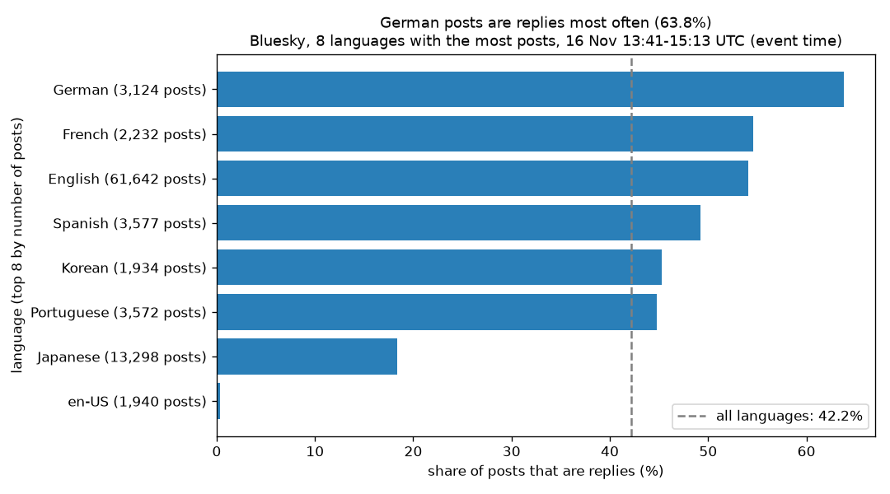

# Who replies on Bluesky? Reply share by language from a live Kafka stream

**Author:** Wilson Fredbeck
**DS 3022 Data Project 3, Fall 2026**

## Data source

Live posts from **Bluesky**, read through **Jetstream**, a free public service that turns the Bluesky firehose into plain JSON over a WebSocket:

`wss://jetstream2.us-east.bsky.network/subscribe?wantedCollections=app.bsky.feed.post`

- **Push**, not pull: one WebSocket connection stays open and Jetstream sends every new or deleted post on the network as it happens. `wantedCollections=app.bsky.feed.post` filters to posts only, so no subscribe message is needed.
- No account, API key or User-Agent is needed.
- One message is one event: `did` (the account), `time_us` (event time, microseconds since 1970), `kind` (`commit` for posts; `identity` and `account` events also arrive), and `commit.operation` (`create` or `delete`), `commit.rkey` (the post id within the account) and `commit.record` (text, `langs`, and `reply` if the post is a reply).
- Measured rate with `python probe.py bluesky`: **39.64 messages per second** (2,379 in 60 s), so 50,000 records take about 21 minutes. While the producer ran it sent about 1,000 messages every 18-25 s.
- No backfill: I collected live on 16 Nov 2026, 13:41-15:13 UTC (event time).

## How to run

From a fresh clone (macOS / Linux; Windows PowerShell differences in comments). Docker Desktop must be running.

```bash
git clone https://github.com/wilsonfredbeck7/ds3022-streaming.git
cd ds3022-streaming
python3 -m venv .venv
source .venv/bin/activate              # Windows: .venv\Scripts\Activate.ps1
pip install -r requirements.txt
pip install prefect matplotlib requests tornado duckdb quixstreams

docker compose up -d
docker exec -it redpanda-0 rpk cluster info                              # 3 brokers
docker exec -it redpanda-0 rpk topic create bluesky_posts -p 3 -r 3      # before the producer

cd project3
python producer.py          # terminal 1: live posts -> topic bluesky_posts (Ctrl+C to stop)
python lander.py            # terminal 2: topic -> data/raw/*.parquet (Ctrl+C to stop)
python four_numbers.py did,rkey    # optional quick count of data/raw

python flow.py              # full data: data/raw -> bluesky.duckdb -> charts/replies_by_language.png
python flow.py data/sample  # the committed sample, no Kafka needed
```

Optional: to see runs in the Prefect dashboard, in another terminal run `prefect config set PREFECT_API_URL=http://127.0.0.1:4200/api` and then `prefect server start`, and open http://127.0.0.1:4200. Without it the flow still runs.

Every terminal needs the virtual environment active and must be in `project3` for the project commands.

## Architecture

```
Bluesky Jetstream (WebSocket, push)
        │  {"action": "live", "data": <Jetstream event>}, key = did
        ▼
producer.py ──► Kafka topic  bluesky_posts  (3 partitions, replication factor 3, Redpanda brokers 0-2)
        │
        ▼
lander.py   (consumer group bluesky_posts_lander; 1,000 records or 60 s per file; .tmp then rename;
        │    offsets stored only after the file exists)
        ▼
data/raw/bluesky_<UTC time>_<id>.parquet   (13 columns + raw JSON)
        │
        ▼
flow.py  (Prefect flow "bluesky-pipeline", DuckDB file bluesky.duckdb)
   load_raw  ──► raw_posts
   stage     ──► stg_records                 (one copy per Kafka record; no malformed or non-post events)
   entities  ──► posts                       (one row per post: did + rkey, latest operation)
   marts     ──► mart_replies_by_language    (posts, replies, % replies, % of all posts per language)
   chart     ──► charts/replies_by_language.png
```

Evidence: `docs/topic.png` (topic with 3 partitions), `docs/flow_log.png` (the four numbers), `docs/prefect_dashboard.png` (a completed run with its five tasks).

## Design decisions

1. **Key and partitions.** The key is `did`, the account that posted. Every event of one account goes to the same partition in order, so a post's `create` and a later `delete` stay in sequence and the latest version is the one with the higher offset. With tens of thousands of accounts (33,854 posted in English alone), the keys spread evenly: my first 3,914 messages split 1,408 / 1,219 / 1,287 over the 3 partitions. A key like `lang` would put about half of all posts (English) in one partition, and no key would lose the per-account order.
2. **Batch size and time.** I kept 1,000 records or 60 seconds per file. At about 45-55 messages per second, the 1,000-record rule closes almost every batch, about every 20 seconds, which makes roughly 160-180 files per hour of live collection. The 60-second rule only closes the last, smaller batch when the producer stops (for example 914, 412 and 750 records in my runs). When the lander catches up on a backlog, it writes several 1,000-record files per second (87 files in about 35 s after D3).
3. **Offsets after the file.** If the lander crashes after writing a file but before storing offsets, that batch is read and landed again on restart. Card D1 showed exactly this: raw went up by 32,412 for 31,412 new records, because 1,000 records landed twice. I accept it because duplicates are easy to remove later with `DISTINCT` on partition + offset, while the opposite order (offsets first) could lose a batch for ever if the crash came before the file was written. At-least-once plus deduplication is safer than at-most-once.
4. **Duplicates.** Two rows are the **same Kafka record** when they have the same `kafka_partition` + `kafka_offset` (landed twice, card D1). `stage()` removes them with `SELECT DISTINCT * EXCLUDE (landed_at)`: 124,077 raw rows became 121,433 staged records after removing the 1,000 copies, the 1 malformed row and about 1,643 account/identity events. Two records are the **same post** when they have the same `did` + `rkey` (for example a post created and then deleted, or a post sent again after a replay). `entities()` keeps one row per post with `QUALIFY row_number() OVER (PARTITION BY did, rkey ORDER BY time_us DESC, kafka_offset DESC) = 1`, the latest version: 121,433 records became 119,943 posts.
5. **Windows and time.** The analysis uses **event time**, `make_timestamp(time_us)` in UTC, never `landed_at`. My lander was not running for about 50 minutes during card D3 and then landed 87,000 records in 35 seconds; by landing time that would look like a gap and then a huge spike that never happened on Bluesky. My question is a comparison between languages rather than a time window, because I collected about 1.5 hours (13:41-15:13 UTC), too short for an hour-of-day pattern. The chart states that window in its subtitle.
6. **Ten times the volume.** At about 450 messages per second, the lander would write a 1,000-record file every 2 seconds, about 1,800 small files per hour, and `load_raw()` re-reads every file on every run, so the flow would slow down first. I would raise the batch size (for example 10,000 records), compact old files, and make the flow incremental instead of `CREATE OR REPLACE` over all of raw. With more partitions I could also run several landers in the same consumer group so each reads its own partitions.

## Chaos round

| Card | Prediction | What I did | Numbers before → after | Explanation |
|---|---|---|---|---|
| D1 Crash between file and offsets | raw goes up by the new records plus one extra batch of 1,000 landed twice; unique Kafka records and posts go up by the new records only | Stopped the lander; ran `python producer.py` (31,412 new records, topic 3,914 → 35,326); `python lander.py crash` (1 file of 1,000, then exit before storing offsets); `python lander.py`; `python four_numbers.py did,rkey` | raw 3,914 → 36,326; malformed 0 → 0; unique records 3,914 → 35,326; unique posts 3,835 → 34,500 | At-least-once: offsets are stored only after the file exists. The crash left those 1,000 records uncommitted, so the restarted lander read and landed them again (raw +32,412 = 31,412 new + 1,000 copies). The copies have the same partition + offset, so unique Kafka records rose only by 31,412. `stage()` removes them with `DISTINCT`. |
| D2 Poison message | raw +1 and malformed +1; unique records and posts unchanged; the lander keeps running | `docker exec -it redpanda-0 rpk topic produce bluesky_posts -k bad`, typed `this is not JSON` (partition 1, offset 11937); waited for `Landed 1 records`; counted | raw 36,326 → 36,327; malformed 0 → 1; unique records 35,326 → 35,326; unique posts 34,500 → 34,500 | `to_row()` caught the JSON error and landed the text with `action = 'malformed'`, so the lander did not crash and the partition was not blocked. A lander that crashed on it would read it again after every restart. Land everything, decide later: `stage()` excludes it. |
| D3 Broker down | The producer and lander pause a few seconds at most while leaders move; nothing is lost, because every partition has 3 replicas | Producer and lander running; `docker stop redpanda-1` at 15:28 (local), started again with `docker start redpanda-1` at 16:12 (44 minutes down); producer ran about 45 minutes in total; started the lander again; counted with `rpk topic describe -p` and `four_numbers.py` | raw 36,327 → 124,077; malformed 1 → 1; unique records 35,326 → 123,076; unique posts 34,500 → 119,943 (topic total 35,327 → 123,077) | Prediction half right. The producer logged `Disconnected` and `Connection refused` at 15:28:26, then kept sending (3,000 at 15:28:33). With replication factor 3, the partition leaders moved to the two other brokers. My lander was not running during the card (I had stopped it while switching terminals), so raw stayed at 36,327 until I started it again; it then caught up from its stored offsets. Unique records 123,076 = topic total 123,077 − 1 malformed, so nothing was lost. |

A bonus like card D4 happened by itself: my Wi-Fi dropped from 15:38 to 15:54. The producer logged `Connection failed: gaierror(8, 'nodename nor servname provided, or not known')` and `Reconnecting in 5 s` until 15:54:34, then reconnected and kept sending with no help from me. Posts from that gap are missing (a push source with no replay), but nothing was duplicated.

## The four numbers

From the flow log on the full data (screenshot in `docs/flow_log.png`); both runs on each dataset gave the same numbers.

| Number | Full data | Sample (`data/sample`) |
|---|---:|---:|
| Raw records landed | 124,077 | 5,000 |
| Malformed (kept in raw) | 1 | 0 |
| Unique Kafka records | 121,433 | 4,922 |
| Unique posts | 119,943 | 4,918 |

`four_numbers.py` reported 123,076 unique Kafka records on the full data; the flow reports 121,433 because `stage()` also drops about 1,643 account and identity events, which are not posts. The sample is 5,000 random rows of the 124,077, so it happened not to include the single malformed row.

## Challenges / Obstacles

- **A very fast source.** Bluesky sends about 40-55 posts per second, so I changed the producer's logging from one line per event to one line per 1,000 messages and filtered to posts in the Jetstream URL (`wantedCollections`).
- **Not every message is a post.** Jetstream also sends account and identity events with no `commit`, and deleted posts have no `record`. The lander reads every field with `.get()`, so these land with NULL columns, and `stage()` keeps only `kind = 'commit'` rows with a `did` and `rkey`.
- **Connections drop.** The class producer stopped when the server closed the connection; I added the reconnect loop from the worksheet. It was tested for real when my Wi-Fi dropped for 16 minutes.
- **A lander that was not running.** During card D3 I noticed raw had not grown: I had stopped the lander while switching terminals. Because the records stayed in the topic and offsets are stored after each file, starting it again was enough to catch up with nothing lost.
- **Working across terminals.** Running producer, lander, commands and the Prefect server at once was confusing at first; I gave each terminal one job and checked every step with `rpk topic describe -p` and `four_numbers.py`.
- **Tools:** Redpanda (Kafka) in Docker, quixstreams, tornado WebSockets, DuckDB, Parquet, Prefect, matplotlib.

## Analysis

**Question:** Which languages post the most on Bluesky, and which of them have the highest share of replies rather than original posts? Over 119,943 posts (16 Nov 2026, 13:41-15:13 UTC, event time), 42.2% of all created posts were replies. English dominates by volume (61,642 posts), but **German posts are replies most often (63.8%)**, followed by French and English at about 54%. Japanese, the second-largest language with 13,298 posts, is the opposite: only about 18% are replies, so Japanese users on Bluesky mostly post new content rather than join threads. The surprise was `en-US`, a separate tag from `en`: its 1,940 posts are almost never replies, and they come from only **80 accounts, 24.3 posts per account**, against 1.8 posts per account for `en` (33,854 accounts) and `ja`. That looks like a few heavy, likely automated accounts rather than conversation, but I did not verify it. **Limitation:** the language is whatever the posting app declares in `langs` (I used the first one), so `en` and `en-US` are split and some posts are mislabelled; and 1.5 hours of one weekday in UTC is afternoon in Europe, morning in the Americas and late night in Japan, so the reply shares may change with the time of day.

## Plot / Visualization



`charts/replies_by_language.png`: one bar per language (the 8 with the most posts), x axis = share of posts that are replies (%), dashed line = all languages (42.2%), label = number of posts. Made by `chart()` from `mart_replies_by_language`.

## Reflection

Before 22 Oct I thought of data as a file you download and then analyze. This project showed me what changes when the data never stops. The system has to keep working while things break and the chaos round made that concrete. I predicted the numbers before each card, and seeing raw go up by exactly 1,000 extra rows after the crash made "at least once" make sense in a way the slides had not. The broker card surprised me because the producer kept going with a broker down, and when I found my lander had not been running, nothing was lost because the records waited in Kafka. I also learned why every stage needs its own count, because a single number would have hidden both kinds of duplicates. If I started again, I would start collecting on the first day instead of catching up, so I could ask an hour of day question with several days of data, and I would watch the lander's output during every card instead of assuming it was still running.

## Acknowledgements

- Starting code: Professor Magee's `stream-seismic.py` (learn-kafka) and the class scripts `quakes_producer.py`, `quakes_lander.py` and `quakes_flow.py`. The WebSocket connector, the Bluesky `SCHEMA` / `to_row()`, `four_numbers.py`, `stage()`, `entities()` and the flow function follow the Session 1-3 worksheets (Appendix A). The Jetstream URL comes from `probe.py`.
- **AI assistance:** I used Claude (Anthropic) throughout as a guide: to walk me through the catch-up setup and worksheets, to adapt the class scripts to Bluesky following the worksheet appendices, and to write `marts()` and `chart()` for my question. I checked the work by running every step myself including partition counts with `rpk topic describe -p`, keys with `rpk topic consume`, the four numbers before and after each chaos card against my written predictions, two identical flow runs on the full data and on the sample, and a separate DuckDB query for the `en-US` accounts finding. I reviewed and edited the text so it says what I did and found.